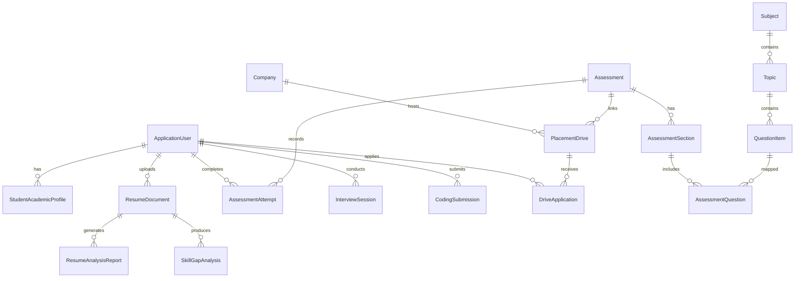

# System Context & Specification: Placement Prep (.NET / C#)

> **Document Type:** Master Architectural Context & Technical Specification  
> **Source Material:** `Placement_Prep_24SOECE11115 (1).docx` (TCIE-I Wireframe-Figma Design Submission)  
> **Target Framework:** C# / .NET (ASP.NET Web Application / MVC / Web API)  
> **Document Purpose:** Complete page-by-page functional decomposition, logic verification, data flow diagrams, navigation graph, and database schema mapping for developing the Placement Prep platform.

---

## 1. Executive Summary & Platform Overview

**Placement Prep** is an enterprise-grade, AI-powered placement preparation and campus recruitment automation platform. It is engineered for higher education institutions (Engineering & Technology faculties, Training & Placement Cells, and Students) to streamline the complete journey from student onboarding to campus recruitment offer rollout.

### 1.1 Core Objectives
1. **Unified Preparation Hub:** Single integrated portal for aptitude training, algorithmic coding, AI mock interviews, and resume intelligence.
2. **AI Resume Intelligence:** Automated parser generating ATS scores, matching skills against industry benchmarks, identifying keyword gaps, and delivering targeted resume enhancement advice.
3. **Adaptive Assessments:** Comprehensive Question Bank for Quantitative, Logical, Verbal, Core CS, and Coding challenges with automated grading, time-tracking, and step-by-step reviews.
4. **AI-Driven Mock Interviews:** Multi-modal simulated interviews (Technical, Behavioral STAR method, System Design, Business Cases) with speech-to-text live transcription, video telemetry, emotional/clarity sentiment scoring, and remediation drills.
5. **Actionable Skill Gap & Readiness Scoring:** Dynamic placement readiness index computed across aptitude, DSA, and soft skills with automated personalized learning paths.
6. **Institutional Governance & Corporate Empanelment:** Robust Faculty and Admin portals for curriculum syllabus mapping, automated placement drive pipelines, proctoring compliance, and NBA/NAAC accreditation reporting.

### 1.2 Target User Roles & Permissions Matrix
| Role | Landing Entry | Scope & Key Capabilities |
| :--- | :--- | :--- |
| **Student** | Page 4 (Dashboard) | Profile onboarding, resume upload/viewer/ATS report, aptitude practice & review, live code editor, AI mock interview room, feedback hub, skill gap roadmap. |
| **Faculty / Mentor** | Page 20 (Overview) | Batch readiness tracking, student mentoring profile & performance details, syllabus & topic weightage configuration, cohort performance analytics, remedial module assignment, prompt fine-tuning. |
| **Admin / TPO** | Page 34 (Overview) | Superuser system telemetry, user management (RBAC), central question repository, test scheduling & proctoring lockdown, corporate empanelment, placement drive sync & candidate nomination, system audit logs, global settings. |
| **Public / Guest** | Page 51 (Landing) | Public institution placement showcase, promotional statistics, role selection, self-registration, and email OTP verification. |

---

## 2. Global Navigation & Logical State Architecture

```mermaid
graph TD
    %% Public Auth Flow
    P51[Page 51: Landing Page] --> P52[Page 52: Select Role]
    P52 --> P53[Page 53: Register]
    P52 --> P55[Page 55: Login]
    P53 --> P54[Page 54: Verify Email OTP]
    P55 --> P56[Page 56: Forgot Password]
    P56 --> P57[Page 57: Reset Password]
    P57 --> P55

    %% Role Dispatching Post-Auth
    P54 -->|Student Role| P1[Page 1: Onboarding - Academic]
    P55 -->|Student Role & Completed Onboarding| P4[Page 4: Student Dashboard]
    P55 -->|Faculty Role| P20[Page 20: Faculty Dashboard]
    P55 -->|Admin Role| P34[Page 34: Admin Platform Overview]

    %% Student Onboarding Funnel
    P1 --> P2[Page 2: Target Companies]
    P2 --> P3[Page 3: Skill Assessment]
    P3 --> P4

    %% Student Core Loops
    P4 --> P5[Page 5: Resume Upload] --> P6[Page 6: Resume Viewer]
    P6 --> P7[Page 7: AI Resume Analysis]
    P6 --> P18[Page 18: Skill Gap Analysis]
    
    P4 --> P8[Page 8: Aptitude Practice] --> P9[Page 9: Test Results] --> P10[Page 10: Test Review]
    P4 --> P11[Page 11: Select Interview Mode] --> P12[Page 12: Live Interview] --> P13[Page 13: Feedback Hub] --> P14[Page 14: Interview Feedback Report]
    P4 --> P15[Page 15: Coding Problem Directory] --> P16[Page 16: Problem Details] --> P17[Page 17: Code Editor]

    %% Faculty Workflows
    P20 --> P21[Page 21: Student Management] --> P22[Page 22: Student Profile] --> P23[Page 23: Student Performance Details]
    P20 --> P24[Page 24: Curriculum Management]
    P20 --> P25[Page 25: Performance Analytics]
    P20 --> P26[Page 26: Test & Interview Reports] --> P27[Page 27: Placement Readiness Matrix]
    P20 --> P28[Page 28: Report Builder]
    P20 --> P29[Page 29: AI Prompt Configuration]
    P20 --> P30[Page 30: Company Directory]
    P20 --> P31[Page 31: System Logs]

    %% Admin Workflows
    P34 --> P35[Page 35: User Management]
    P34 --> P36[Page 36: Central Question Bank] --> P37[Page 37: Question Bank List]
    P34 --> P38[Page 38: Test Management] --> P39[Page 39: Create Assessment] --> P40[Page 40: Question Selection Cart] --> P41[Page 41: Assessment Preview & Publish]
    P38 --> P42[Page 42: Test Details]
    P34 --> P43[Page 43: Admin Student Management] --> P44[Page 44: Admin Student Dossier]
    P34 --> P45[Page 45: Company Management] --> P46[Page 46: Placement Drive Management] --> P47[Page 47: Placement Drive Details]
    P42 -->|Export Shortlisted Candidates| P47
    P34 --> P48[Page 48: Admin Reports & Analytics]
    P34 --> P49[Page 49: Admin System Logs]
    P34 --> P50[Page 50: Admin Settings]
```



---

## 3. Comprehensive Page-by-Page Specifications (Pages 1 to 58)

### Module 1: Student Onboarding Module (Pages 1 - 3)

#### Page 1: Academic Background
- **Screen Name:** `Onboarding - Academic Background`
- **Module:** Student Onboarding (Step 1 of 3)
- **Functional Purpose:** Captures foundational collegiate academic data used to set baseline placement drive eligibility rules and calibrate curricula.
- **UI Elements & Form Controls:**
  - Progress indicator: Step 1 of 3
  - Degree selector (e.g., B.Tech, M.Tech, MCA, BCA)
  - Department / Specialization dropdown (CSE, IT, ECE, Data Science, etc.)
  - Expected Graduation Year dropdown (e.g., 2024, 2025, 2026)
  - Current CGPA input (Float precision, 0.00 to 10.00)
  - Action buttons: `Next`, `Help`
- **Logic & Verification:**
  - *Validation:* CGPA must be positive and $\le 10.00$. All fields mandatory.
  - *State Save:* Stores record into `StudentAcademicProfiles` linked to the authenticated user ID.
- **Navigation:**
  - Inbound: From `Page 54 (Verify Email OTP)` on first login for Student role.
  - Outbound: `Next` $\rightarrow$ `Page 2 (Target Companies)`.

#### Page 2: Target Companies
- **Screen Name:** `Onboarding - Target Companies`
- **Module:** Student Onboarding (Step 2 of 3)
- **Functional Purpose:** Collects target employers to tailor mock interviews, question banks, and company-specific assessment tracks.
- **UI Elements & Form Controls:**
  - Progress indicator: Step 2 of 3
  - Search bar with dynamic company autocomplete
  - Category filter pills: `All`, `Big Tech / FAANG`, `Fintech`, `Consulting`, `Automotive / Core`
  - Multi-select company cards with logos and selected badge indicators
  - Action buttons: `Back`, `Next Step`, `Need Help`
- **Logic & Verification:**
  - *Validation:* At least 1 target company must be selected before enabling `Next Step`.
  - *State Save:* Writes to `StudentTargetCompanies` join table.
- **Navigation:**
  - Inbound: `Page 1 (Academic Background)`.
  - Outbound: `Next Step` $\rightarrow$ `Page 3 (Skill Assessment)`; `Back` $\rightarrow$ `Page 1`.

#### Page 3: Skill Assessment
- **Screen Name:** `Onboarding - Skill Assessment`
- **Module:** Student Onboarding (Step 3 of 3)
- **Functional Purpose:** Establishes self-reported competency baselines across programming, problem-solving, and communication to seed adaptive algorithms.
- **UI Elements & Form Controls:**
  - Progress indicator: Step 3 of 3 (Final Step)
  - Proficiency Sliders / Rating Radios:
    - Java Proficiency (Core & Advanced) [Beginner / Intermediate / Advanced]
    - Python Proficiency (Scripting & Data) [Beginner / Intermediate / Advanced]
    - Aptitude Proficiency (Quantitative & Logic) [Beginner / Intermediate / Advanced]
    - Soft Skills Proficiency (Communication & Group Discussion) [Beginner / Intermediate / Advanced]
  - Informational callout: "Adaptive Curriculum Information Note"
  - Action buttons: `Back`, `Finish Setup`
- **Logic & Verification:**
  - *Validation:* All 4 competency axes must be rated.
  - *State Transition:* Sets `IsOnboardingCompleted = true` on `AspNetUsers` profile.
- **Navigation:**
  - Inbound: `Page 2 (Target Companies)`.
  - Outbound: `Finish Setup` $\rightarrow$ `Page 4 (Student Dashboard)`; `Back` $\rightarrow$ `Page 2`.

---

### Module 2: Student Dashboard & Preparation Modules (Pages 4 - 19)

#### Page 4: Student Dashboard
- **Screen Name:** `Student Home Dashboard`
- **Module:** Student Core
- **Functional Purpose:** Central cockpit for student workflow: upcoming tests, ongoing progress, resume status, and direct launchpads for prep tools.
- **UI Elements & Components:**
  - Personalized welcome message with scheduled test counters
  - Scheduled Tests cards: "Data Structures Core", "Quantitative Set A" with `Launch Module` and `Review Syllabus` actions
  - `Resume Last Module` sticky action
  - Subject Mastery Progress meters: Technical Core (DSA), Quantitative, Soft Skills
  - Recent Submissions preview widget (e.g., "Binary Search - Passed")
  - Monthly interactive test calendar and upcoming deadlines widget
  - Global Search bar, Notification tray, Settings, Profile Avatar
- **Logic & Verification:**
  - Renders dynamic data aggregated from `Assessments`, `Submissions`, and `ReadinessIndex`.
  - If a scheduled test's time window has expired, disallow `Launch Module`.
- **Navigation:**
  - Outbound:
    - $\rightarrow$ `Page 5 (Resume Upload)` via Resume Analyzer link.
    - $\rightarrow$ `Page 8 (Aptitude Practice)` via Quantitative module.
    - $\rightarrow$ `Page 11 (Select Interview Mode)` via Interview Prep.
    - $\rightarrow$ `Page 13 (Feedback Hub)` via Feedback link.
    - $\rightarrow$ `Page 15 (Coding Problem Directory)` via Coding Problems.

#### Page 5: Resume Upload
- **Screen Name:** `Upload Your Resume`
- **Module:** Resume Intelligence
- **Functional Purpose:** Secure intake of candidate resume documents for automated AI parsing and ATS benchmarking.
- **UI Elements & Form Controls:**
  - Drag-and-drop file upload zone + Browse button
  - Format restriction labels: `.PDF`, `.DOCX` (Max file size: 5MB)
  - Parsing tips banner and "View Optimal Templates" link
  - Recent uploads history table (File name, upload date, parsing status)
  - Target ATS baseline metric and institutional privacy notice
- **Logic & Verification:**
  - *Validation:* MIME type whitelist: `application/pdf`, `application/vnd.openxmlformats-officedocument.wordprocessingml.document`. Strict 5MB file-size validation.
  - Background asynchronous task trigger: `ResumeParsingService.ParseResumeAsync(fileId)`.
- **Navigation:**
  - Inbound: `Page 4 (Dashboard)`.
  - Outbound: Successful upload/click $\rightarrow$ `Page 6 (Resume Viewer)`.

#### Page 6: Resume Viewer
- **Screen Name:** `Resume Viewer`
- **Module:** Resume Intelligence
- **Functional Purpose:** Split-screen interface: renders rendered resume artifact on the left and structured extracted entities on the right.
- **UI Elements & Components:**
  - Header: Uploaded filename, parsed status badge, `Export JSON`, `Run Gap Analysis`, `Final Report`
  - Left Pane: PDF viewer with zoom controls, page flipping, and full-screen preview
  - Right Pane: AI-extracted sections:
    - Education records (Degrees, Colleges, CGPA)
    - Work & Project Experience (Roles, Technologies, Durations)
    - Technical skills tag cloud
    - Parsability score metric (0 - 100%)
- **Logic & Verification:**
  - If parsing is in progress, display a loading shimmer state.
  - Exports validated JSON matching `ResumeExtractionDTO`.
- **Navigation:**
  - Inbound: `Page 5 (Resume Upload)`.
  - Outbound: `Run Gap Analysis` $\rightarrow$ `Page 18 (Skill Gap Analysis)`; `Final Report` $\rightarrow$ `Page 7 (AI Resume Analysis)`.

#### Page 7: AI Resume Analysis
- **Screen Name:** `Resume Analysis Report`
- **Module:** Resume Intelligence
- **Functional Purpose:** In-depth evaluation report detailing ATS match against desired roles, missing keywords, bullet point rewrites, and PDF export.
- **UI Elements & Components:**
  - ATS Match Score gauge (0 - 100%) against selected Target Role
  - Extracted hard skills matching company criteria
  - Missing key terms / missing competencies chip cloud
  - Keyword density radar and length/formatting compliance checks
  - Strengths and areas for improvement breakdown
  - AI Action Plan (e.g., "Quantify impact in Project 2", "Inject 'Microservices' into experience")
  - Actions: `Re-Analyze`, `Export PDF`
- **Logic & Verification:**
  - Calculated based on cosine similarity or LLM evaluation of resume tokens vs. job description profiles.
- **Navigation:**
  - Inbound: `Page 6 (Resume Viewer)`.
  - Outbound: `Re-Analyze` re-triggers AI; `Export PDF` streams generated binary.

#### Page 8: Aptitude Practice
- **Screen Name:** `Aptitude Practice`
- **Module:** Aptitude & Cognitive Testing
- **Functional Purpose:** Category selection and drill setup for competitive placement aptitude tests.
- **UI Elements & Components:**
  - Practice Category Cards:
    - Quantitative Aptitude (Arithmetic, Algebra, Probability)
    - Logical Reasoning (Puzzles, Syllogisms, Blood Relations)
    - Verbal Ability (Reading Comprehension, Grammar, Sentence Correction)
    - Data Interpretation (Tables, Pie Charts, Bar Graphs)
  - Question count and estimated completion time per category
  - Weekly goal progress bar (e.g., "45 / 100 questions completed")
  - `Start Practice` action button per card
- **Logic & Verification:**
  - Generates a randomized practice session from the active central question pool matching category ID.
- **Navigation:**
  - Inbound: `Page 4 (Dashboard)`.
  - Outbound: `Start Practice` $\rightarrow$ `Page 9 (Test Results)` (post exam completion).

#### Page 9: Test Results
- **Screen Name:** `Quantitative Aptitude Set A - Result`
- **Module:** Aptitude & Cognitive Testing
- **Functional Purpose:** Immediate diagnostic debrief post-test completion.
- **UI Elements & Components:**
  - Test status badge: "Completed"
  - Overall score banner (e.g., 28 / 30)
  - Performance telemetry cards: Accuracy %, Time Taken (mm:ss), Percentile Rank vs. Batch
  - Question Breakdown donut chart: Correct, Incorrect, Unanswered
  - Topic proficiency breakdown bars
  - AI Recommendation box with `Start 15-Min Focused Drill` action
  - `View Detailed Review` button
- **Logic & Verification:**
  - Scores computed applying negative marking rules (if configured for test).
  - Percentile calculated dynamically against all student attempts for this test ID.
- **Navigation:**
  - Inbound: Practice module / completed test submission.
  - Outbound: `View Detailed Review` $\rightarrow$ `Page 10 (Test Review)`.

#### Page 10: Test Review
- **Screen Name:** `Quantitative Aptitude Review`
- **Module:** Aptitude & Cognitive Testing
- **Functional Purpose:** Itemized review of every question with answers, candidate choice, time spent, and pedagogical explanations.
- **UI Elements & Components:**
  - Question filter pills: `All`, `Correct`, `Incorrect`, `Unanswered`
  - Question stepper navigation bar (1 to N)
  - Active question container: Question text, diagrams/formulas, option list
  - User's selected choice indicator vs. Verified correct answer indicator
  - Time spent on this specific question
  - Comprehensive Step-by-Step explanation box and "Shortcut Tip / Trick" callout
  - Navigation controls: `Previous Question`, `Next Question`, `Return to Question Bank`
- **Logic & Verification:**
  - Read-only review state preventing answer modifications.
- **Navigation:**
  - Inbound: `Page 9 (Test Results)`.
  - Outbound: `Question Bank` $\rightarrow$ `Page 8 (Aptitude Practice)`.

#### Page 11: Select Interview Mode
- **Screen Name:** `Select Interview Mode`
- **Module:** AI Mock Interview System
- **Functional Purpose:** Configures parameters, persona, domain, and rigor for an upcoming AI mock interview.
- **UI Elements & Components:**
  - Interview Engine header (Model version, Adaptive difficulty switch)
  - Candidate readiness score and total completed sessions stats
  - Mode Selection Cards:
    1. **Technical Core Mode:** Data Structures, OS, DBMS, Networks, Language fundamentals (`Configure Environment`)
    2. **Behavioral & Fit Mode:** Leadership, Conflict Resolution, STAR Framework (`Select Competencies`)
    3. **System Design Mode:** High-level architecture, scalability, latency, database sharding (`Choose Scope`)
    4. **Business Case Mode:** Market sizing, consulting frameworks (`Browse Cases`)
  - Recent Telemetry summary & `Start New Mock Interview` primary button
- **Logic & Verification:**
  - Mode selection dictates prompt template ID sent to the AI interview engine.
- **Navigation:**
  - Inbound: `Page 4 (Dashboard)`.
  - Outbound: `Start New Mock Interview` $\rightarrow$ `Page 12 (Live Interview)`.

#### Page 12: Live Interview
- **Screen Name:** `Live Interview Session`
- **Module:** AI Mock Interview System
- **Functional Purpose:** Interactive real-time interview environment combining AI conversational video/audio with real-time speech transcription and dynamic evaluation.
- **UI Elements & Components:**
  - Live session header with stage indicator (e.g., "Stage 2 of 4") and active countdown timer
  - Video panes: AI Interviewer avatar feed + Student webcam self-view
  - Hardware controls: Mute microphone, camera toggle, speaker volume, device settings
  - Scratchpad / Annotation notes panel
  - Active Question box with topic tags
  - Real-time speech-to-text transcript feed (Interviewer & Candidate dialogues)
  - Live AI Scoring telemetry: Clarity index, Technical depth rating
  - `End Interview` action button
- **Logic & Verification:**
  - Enforces speech activity detection (VAD). Transcribes candidate audio into structured speech turns.
  - On `End Interview`, finalizes audio streams, runs rubric evaluation, and redirects to Feedback Hub.
- **Navigation:**
  - Inbound: `Page 11 (Select Interview Mode)`.
  - Outbound: `End Interview` $\rightarrow$ `Page 13 (Feedback Hub)`.

#### Page 13: Feedback Hub
- **Screen Name:** `Feedback Hub`
- **Module:** Analytics & Mentorship
- **Functional Purpose:** Aggregates holistic evaluations across AI mock interviews and coding assessments.
- **UI Elements & Components:**
  - Cohort telemetry header with `Export All Reports` and `Request Mentor Review` actions
  - Overall Performance score with percentile rank and month-over-month trajectory
  - Key Strength Card (e.g., "Algorithmic Efficiency") & Focus Area Card ("System Scalability")
  - Filter tabs: `All Feedback`, `AI Interviews`, `Code Reviews`, `Mentor Sessions`
  - Feedback Cards with sub-scores:
    - AI Interview Card: STAR structure, Clarity, Technical depth, `View Full Report`
    - Code Test Card: Time complexity, Memory optimization, Correctness, `Review Code`
  - 5-Axis Competency Matrix (Technical Accuracy, Deconstruction, Communication, Architecture, Alignment)
- **Logic & Verification:**
  - Aggregates multi-source rubric evaluations into a unified normalized score (0 - 100).
- **Navigation:**
  - Inbound: `Page 4 (Dashboard)`, `Page 12 (Live Interview)`.
  - Outbound: `View Full Report` $\rightarrow$ `Page 14 (Interview Feedback Report)`.

#### Page 14: Interview Feedback Report
- **Screen Name:** `Interview Feedback - Session Details`
- **Module:** AI Mock Interview System
- **Functional Purpose:** Granular breakdown of a single interview session: rubrics, tone/pace audio analysis, and remediation plan.
- **UI Elements & Components:**
  - Breadcrumb (`Feedback Hub > Session Details`), session metadata, and duration
  - Overall Readiness Score & "Strong Hire Potential" verdict tag
  - Actions: `Export PDF`, `Review Recording` (audio/video player)
  - Communication Rubric: Clarity & Conciseness, STAR method compliance, Active listening flags
  - Technical Accuracy panel with annotated AI feedback against candidate responses
  - Vocal & Sentiment Analysis: Words-per-minute pace gauge, anxiety marker highlights
  - "Ready for the Next Step?" banner with `Start Targeted Drill (10 min)`
- **Logic & Verification:**
  - Flags STAR method gaps if candidate answers lacked Situation, Task, Action, or Result components.
- **Navigation:**
  - Inbound: `Page 13 (Feedback Hub)`.
  - Outbound: `Start Targeted Drill` $\rightarrow$ `Page 8` or `Page 17`; `Export PDF` downloads report.

#### Page 15: Coding Problem Directory
- **Screen Name:** `Coding Problem Directory`
- **Module:** Coding & DSA Lab
- **Functional Purpose:** Curated repository of programming challenges categorized by topic, difficulty, and company tags.
- **UI Elements & Components:**
  - Search bar (by problem title, topic keywords, or target company name)
  - Filters: Difficulty (`Easy`, `Medium`, `Hard`), Topic (`Arrays`, `DP`, `Trees`, `Graphs`), Status (`Solved`, `Attempted`, `Todo`)
  - `Pick One` random challenge generator
  - Problem Table: Status Icon, Title, Difficulty badge, Acceptance rate %, Company tags, Action button (`Solve`, `Resume`, `Review`)
  - Server-side pagination controls
- **Logic & Verification:**
  - Displays user submission status mapped from `CodingSubmissions`.
- **Navigation:**
  - Inbound: `Page 4 (Dashboard)`.
  - Outbound: Click problem / `Solve` $\rightarrow$ `Page 16 (Problem Details)`.

#### Page 16: Problem Details
- **Screen Name:** `Problem Details`
- **Module:** Coding & DSA Lab
- **Functional Purpose:** In-depth review of problem requirements, constraints, examples, and algorithmic approach prior to coding.
- **UI Elements & Components:**
  - Problem Header: Title, Difficulty, Topic tags, Estimated solve time, Bookmark button
  - Problem Statement with rich formatting and mathematical notations
  - Input / Output format specification and Constraints boundaries
  - Sample Test Cases with 1-click `Copy` button
  - Step-by-Step Approach Walkthrough (e.g., Topological sort intuition)
  - "Asked In" company chips (e.g., Amazon, Google, Microsoft)
  - User stats: Total attempts, personal best execution time
  - Actions: `Enter IDE` (Primary), `Read Editorial`, `Request Instant Session`
- **Logic & Verification:**
  - Validates user permissions before opening IDE session.
- **Navigation:**
  - Inbound: `Page 15 (Coding Problem Directory)`.
  - Outbound: `Enter IDE` $\rightarrow$ `Page 17 (Code Editor)`.

#### Page 17: Code Editor
- **Screen Name:** `Code Editor`
- **Module:** Coding & DSA Lab
- **Functional Purpose:** Full-featured in-browser code editor and automated test runner supporting C#, Java, Python, and C++.
- **UI Elements & Components:**
  - Split layout: Problem spec on the left, Code IDE & Terminal on the right
  - Top Toolbar: Language Selector (C#, Java, Python 3, C++), Font size slider, Theme toggle, Reset Code, Fullscreen
  - Code Editor panel with syntax highlighting, line numbering, auto-indent, and auto-save indicator
  - Test Cases tabbed interface (Default Cases 1, 2, 3 + `Add Custom Case`)
  - Action buttons: `Run Code` (executes against visible sample cases), `Submit` (executes against hidden test suite)
  - Output Terminal: Standard output, Execution time (ms), Memory used (MB), Compiler errors / Stack trace, Test pass/fail matrix
- **Logic & Verification:**
  - Secure sandboxed execution environment (e.g., containerized execution or restricted AppDomain/worker process).
  - Verdict determination: `Accepted`, `Wrong Answer`, `Time Limit Exceeded (TLE)`, `Runtime Error`, `Compilation Error`.
- **Navigation:**
  - Inbound: `Page 16 (Problem Details)`.
  - Outbound: `Submit` $\rightarrow$ updates profile stats $\rightarrow$ return to `Page 15` or next problem.

#### Page 18: Skill Gap Analysis
- **Screen Name:** `Skill Gap Analysis`
- **Module:** Analytics & Career Guidance
- **Functional Purpose:** Compares the candidate's verified capabilities against target job descriptions and generates a customized bridging roadmap.
- **UI Elements & Components:**
  - Target Role Benchmark card with `Change Target Role` dropdown
  - Competency Radar Chart: Student Profile vs. Target Role Ideal
  - Overall Role Match Percentage (e.g., 68%)
  - Identified Skill Gaps categorized by severity: Hard (Critical), Medium, Easy
  - Actionable Learning Roadmap items: Recommended Module, Practical Lab, Quick Read
  - Potential Hireability Score Uplift indicator (+18% upon completing recommendations)
  - `Download Report` action
- **Logic & Verification:**
  - Evaluated by comparing candidate test records + resume parsed skills against the job role competency requirements.
- **Navigation:**
  - Inbound: `Page 6 (Resume Viewer)`.
  - Outbound: Direct link to `Page 8` (Aptitude), `Page 15` (Coding), or learning resources.

#### Page 19: Help Center
- **Screen Name:** `Help Center`
- **Module:** Support & Community
- **Functional Purpose:** Student self-service knowledge base, ticket management, and technical drop-in support.
- **UI Elements & Components:**
  - Search bar across articles, error codes, and interview setup guides
  - Filter categories: `Mock Interviews`, `Coding Environment`, `Resume ATS`, `Billing & Cohorts`
  - Accordion FAQ list with expandable answers
  - Ticket Desk: `Open New Ticket`, `View My Tickets`
  - "Live Drop-in Hours" card with `Join Room via SSO`
  - System status indicator and cheat-sheet downloadable files
- **Logic & Verification:**
  - Authenticated ticket submission logged into `SupportTickets` table.
- **Navigation:**
  - Inbound: Student sidebar menu.
  - Outbound: Open ticket modal or external SSO room link.

---

### Module 3: Faculty Dashboard Module (Pages 20 - 33)

#### Page 20: Faculty Dashboard - Batch Readiness Overview
- **Screen Name:** `Faculty Dashboard - Overview`
- **Module:** Faculty Portal
- **Functional Purpose:** Command center for placement coordinators and departmental faculty to monitor batch-level placement readiness and initiate bulk actions.
- **UI Elements & Components:**
  - Global Search bar, Academic Year selector (`2024-25`), Notifications, Settings
  - Primary metric cards:
    - Aptitude Clear Rate (78%, +4% vs last mock)
    - Technical DSA Proficiency (62%)
    - Ready for Placement (142 / 200 Students above readiness threshold)
  - Department Performance Trends Chart (Batch 2024 vs Target Benchmark over 30 days)
  - Quick Actions toolbar: `Schedule Test`, `Post Announcement`, `Find Student`, `Generate Report`, `New Placement Drive`
  - Upcoming Schedule list & Recent Batch Activity stream
- **Logic & Verification:**
  - Metrics auto-computed across active academic cohort assigned to faculty member's department.
- **Navigation:**
  - Inbound: `Page 55 (Login)` with Faculty role.
  - Outbound: Sidebar links to Pages 21, 24, 25, 26, 28, 29, 30, 31, 32.

#### Page 21: Student Management
- **Screen Name:** `Student Management`
- **Module:** Faculty Portal
- **Functional Purpose:** Batch roster administration, cohort filtering, performance status tracking, and student drilldown.
- **UI Elements & Components:**
  - Search by Name, Student Roll Number, or Skill
  - Filters: Department (CS, IT, EC), Cohort Year, Status (`Strong Fit`, `On Track`, `Needs Review`)
  - Cohort statistics: Batch Average %, Total Assessments Completed, "Attention Needed" counter (<60% score)
  - Student Data Table: Student Name, Roll No, Department, Average Score %, Tests Completed, Status Badge, Actions (`View Profile`)
  - Actions: `Add Student`, `Export List (CSV)`
- **Logic & Verification:**
  - "Needs Review" status flag triggers automatically when composite readiness falls below 60%.
- **Navigation:**
  - Inbound: `Page 20 (Faculty Dashboard)`.
  - Outbound: `View Profile` $\rightarrow$ `Page 22 (Student Profile)`.

#### Page 22: Student Profile
- **Screen Name:** `Student Profile`
- **Module:** Faculty Portal
- **Functional Purpose:** Complete faculty view of a student's academic standing, placement readiness, resumes, and verified competencies.
- **UI Elements & Components:**
  - Student header: Photo, Name, Roll No, Degree, Class Year, Top 10% badge, `Message`, `Export Profile`
  - Academic Standing: CGPA, Current Readiness Index
  - Linked profiles: LinkedIn, GitHub, Portfolio URL
  - Contact Details & Document Vault: `Resume_Tech.pdf`, `Resume_Consulting.pdf`, Official Transcripts
  - Verified Skill Badges (e.g., Advanced SQL, System Design, React)
  - `View Assessment Details` action button
- **Logic & Verification:**
  - Enforces faculty privacy and department isolation rules.
- **Navigation:**
  - Inbound: `Page 21 (Student Management)`.
  - Outbound: `View Assessment Details` $\rightarrow$ `Page 23 (Student Performance Details)`.

#### Page 23: Student Performance Details
- **Screen Name:** `Student Performance Details`
- **Module:** Faculty Portal
- **Functional Purpose:** Longitudinal drilldown of a student's test attempts, domain mastery, coding stats, and AI interview transcripts.
- **UI Elements & Components:**
  - Readiness Index score (85/100) and Batch Rank percentile
  - Aptitude Domain scores: Quantitative, Logical, Verbal, Core CS
  - Coding statistics: Total solved, current streak, difficulty breakdown (Easy, Med, Hard)
  - Latest Mock Interview panel: Title ("System Design"), Date, Final Score, `View Full Transcript`
- **Logic & Verification:**
  - Aggregated performance view enabling faculty to write mentorship notes.
- **Navigation:**
  - Inbound: `Page 22 (Student Profile)`.
  - Outbound: `View Full Transcript` modal; Breadcrumb back to `Page 21`.

#### Page 24: Curriculum Management
- **Screen Name:** `Curriculum Management`
- **Module:** Faculty Portal
- **Functional Purpose:** Configures syllabus topics, competency weightages, and maps curriculum units to AI question pools.
- **UI Elements & Components:**
  - Metrics: Active Subjects (24), AI Question Pool (3,420 items), Average Coverage Index (88.4%)
  - Actions: `Add Subject`, `Add Topic`, `Export Syllabus`
  - Subject Table: Subject Name & Code, Department, Semester, Topics count, AI Relevance score, Status toggle
  - Topic Panel (for selected subject): Topic Specification, Category, Difficulty, Exam Weightage %, Associated Questions count
  - Weightage Verification Callout: Topic weightages must sum to exactly 100% before approving Mock Interview Batch generation.
- **Logic & Verification:**
  - *Business Logic Constraint:* Enforces $\sum (\text{Topic Weightages}) == 100\%$ validation rule prior to curriculum publish.
- **Navigation:**
  - Inbound: `Page 20 (Faculty Dashboard)`.
  - Outbound: Opens inline modals for Subject/Topic creation.

#### Page 25: Performance Analytics
- **Screen Name:** `Performance Analytics`
- **Module:** Faculty Portal
- **Functional Purpose:** High-level batch analytics across departments, module completion tracking, and topic weakness heatmaps.
- **UI Elements & Components:**
  - Filter by Semester and Department
  - Overall Readiness Score (78%) and Completed Modules (14,205 / 17,200)
  - Department Benchmarks Bar Chart (CSE, IT, ECE, EEE, MECH)
  - Weak Topic Heatmap: Visual failure percentage across DP, Graphs, SQL Joins, OS Threads, System Design
  - Action: `Deploy Remedial Module` (triggers targeted assignments to students failing specific topics)
- **Logic & Verification:**
  - Deploy Remedial Module queries students with $<50\%$ score in selected weak topics and creates assigned drill tasks.
- **Navigation:**
  - Inbound: `Page 20 (Faculty Dashboard)`.
  - Outbound: `Deploy Remedial Module` confirmation workflow.

#### Page 26: Test & Interview Reports
- **Screen Name:** `Test & Interview Reports`
- **Module:** Faculty Portal
- **Functional Purpose:** Aggregated reporting comparing cohort milestones, interview trends, and assessment pass rates.
- **UI Elements & Components:**
  - High-level KPIs: Total Assessments (1,248), Avg Interview Score (7.8/10), Code Test Pass Rate (82%)
  - Academic & Aptitude Growth Trend line chart (Months 1 to 6)
  - Cohort Comparison matrix (CS Batch A vs. CS Batch B vs. IT Batch A)
  - AI Recommendation insight cards
  - Actions: `View Detailed Breakdown`, Quarter Toggle (`Q1` / `Q2`)
- **Logic & Verification:**
  - Aggregates multi-cohort data points for institutional review meetings.
- **Navigation:**
  - Inbound: `Page 20 (Faculty Dashboard)`.
  - Outbound: `View Detailed Breakdown` $\rightarrow$ `Page 27 (Placement Readiness Matrix)`.

#### Page 27: Placement Readiness Matrix
- **Screen Name:** `Placement Readiness Matrix`
- **Module:** Faculty Portal
- **Functional Purpose:** Comparative matrix benchmarking cohorts across Aptitude, Coding, and Communication with threshold alerts.
- **UI Elements & Components:**
  - Cohort filter pills & Readiness Threshold selector (e.g., `> 75% Readiness`)
  - Matrix Table: Cohort Group (CS-A, CS-B, IT-A, EC-A), Student Count, Aptitude Average, Coding Proficiency, Communication Score, Readiness Index
  - Low Score Warning highlight for any cohort dipping below threshold
  - Actions: `Export CSV`, `Generate PDF`
- **Logic & Verification:**
  - Highlights cells in red/amber if metrics fall below institutional cutoff standards.
- **Navigation:**
  - Inbound: `Page 26 (Test & Interview Reports)`.
  - Outbound: File exports (CSV/PDF).

#### Page 28: Report Builder
- **Screen Name:** `Report Builder`
- **Module:** Faculty Portal
- **Functional Purpose:** Custom report generation tool with flexible parameter selection for accreditation (NBA / NAAC) and company presentations.
- **UI Elements & Components:**
  - Breadcrumb (`Analytics > Custom Exports > Cohort Report Builder`)
  - Saved Templates dropdown & `Save Preset` action
  - Timeframe picker: Custom Date Range or Quick Ranges (Last 7 Days, Last 30 Days, This Semester, YTD)
  - Multi-select departments & engineering streams
  - Metric checkboxes: Aptitude & Reasoning, Technical Coding, Soft Skills, Company Fit Index
  - Live Report Summary: Estimated records, selected streams, completeness metric
  - Actions: `Generate PDF`, `Export CSV`, `Preview Report`
- **Logic & Verification:**
  - Dynamic SQL / EF Core query generation based on selected metric criteria and date filters.
- **Navigation:**
  - Inbound: `Page 20 (Faculty Dashboard)`.
  - Outbound: Triggers report download stream.

#### Page 29: AI Prompt Configuration
- **Screen Name:** `AI Prompt Configuration`
- **Module:** Faculty / Admin Portal
- **Functional Purpose:** Manage, version, test, and deploy system prompts governing AI evaluation models.
- **UI Elements & Components:**
  - Expandable Module Panels:
    1. Resume Analysis Parser
    2. Dynamic Question Generator
    3. Mock Interview Evaluator
    4. Skill Gap Analysis Model
  - Markdown-enabled System Prompt Editor with syntax highlighting & token counter
  - Active model indicator (`gpt-4-turbo` or local LLM)
  - Global Parameters: Default Temperature slider (0.0 to 1.0), Max Tokens, Strict JSON Enforcement toggle
  - API Health Telemetry: Provider, Latency (ms), Error rate %
  - Actions: `Test Output` (runs prompt against test payload), `Deploy Configuration`, `Discard Changes`
- **Logic & Verification:**
  - Version-controlled prompt schema stored in `AIPromptConfigurations` table; rollback capability.
- **Navigation:**
  - Inbound: `Page 20 (Faculty Dashboard)`.
  - Outbound: Live test drawer preview.

#### Page 30: Company Directory
- **Screen Name:** `Company Directory`
- **Module:** Faculty Portal
- **Functional Purpose:** Tracks active recruiting partners, scheduled campus drives, and pipeline stage metrics.
- **UI Elements & Components:**
  - Filters: `All Active`, `Upcoming`, Filter by Industry
  - Company Cards (e.g., TechNova Systems, FinServe Group):
    - Company Logo, Drive status tag (`Active Drive`, `Upcoming`, `Interview Phase`)
    - Role Title, CTC Package offer
    - Eligible departments list
    - Applicant Pipeline funnel: Applied $\rightarrow$ Aptitude $\rightarrow$ Interview $\rightarrow$ Selected
    - Actions: `View Details`, `Manage Schedule`, `Monitor Panel`
- **Logic & Verification:**
  - Aggregates live application states from `PlacementDriveApplications`.
- **Navigation:**
  - Inbound: `Page 20 (Faculty Dashboard)`.
  - Outbound: `View Details` opens company drive modal.

#### Page 31: System Logs
- **Screen Name:** `System Logs`
- **Module:** Faculty / Admin Portal
- **Functional Purpose:** Audit trail for administrative actions, AI pipeline executions, authentication events, and errors.
- **UI Elements & Components:**
  - Telemetry summary: 24h Event Volume, AI Pipeline Invocations, Warnings Flagged, Critical Errors
  - Filter bar: Actor search, Time filter (Last 24h, 7d), Role filter, Severity (`Info`, `Warning`, `Error`)
  - Log Table: Timestamp, Actor ID, Role, Target Module, Event Name, Severity
  - Log Detail Inspection Drawer: Event ID, Client IP, API Endpoint, Action Synopsis, Payload Diff (with `Copy JSON`), Raw HTTP Headers, Full Stack Trace
  - Actions: `Refresh`, `Export Logs`, `Audit Rules`
- **Logic & Verification:**
  - High-performance append-only audit log store.
- **Navigation:**
  - Inbound: `Page 20 (Faculty Dashboard)`, `Page 34 (Admin Overview)`.
  - Outbound: Row click opens slide-out inspector.

#### Page 32: Faculty Help Center & Documentation
- **Screen Name:** `Help Center & Documentation`
- **Module:** Faculty Portal
- **Functional Purpose:** Procedural guides, administrative documentation, diagnostics, and IT hotline access for coordinators.
- **UI Elements & Components:**
  - Knowledge search bar with trending faculty topics ("Import Students", "AI Prompts", "Drive Eligibility")
  - System Status Health Cards (AI Engine, SIS Sync, Accreditation Exporter)
  - Knowledge categories: Getting Started, Student Management, AI Assessment & Mocks, Company Drives, Accreditation
  - Self-Diagnostics runner (`Run Self-Diagnostics`)
  - Document Downloads: Faculty Handbooks, CSV import templates
  - Support contacts: Placement Operations Desk, Campus IT Hotline
- **Logic & Verification:**
  - Self-diagnostics executes ping/check queries on database, AI endpoint, and SMTP services.
- **Navigation:**
  - Inbound: `Page 20 (Faculty Dashboard)`.

#### Page 33: Edit Profile Settings
- **Screen Name:** `Profile Settings - Edit Profile`
- **Module:** Faculty Portal
- **Functional Purpose:** Manage faculty account credentials, personal information, and two-factor authentication.
- **UI Elements & Components:**
  - Profile photo with change/remove actions
  - Full Name, Email Address, Contact Phone
  - Read-Only Staff ID / Employee Roll Number
  - Department selector
  - Password management: Current Password, New Password, Confirm Password
  - Two-Factor Authentication (2FA) toggle switch
  - Actions: `Save Changes`, `Cancel`
- **Logic & Verification:**
  - Standard ASP.NET Identity password complexity validation.
- **Navigation:**
  - Inbound: User avatar menu.
  - Outbound: `Save Changes` updates identity profile.

---

### Module 4: Admin Panel Module (Pages 34 - 50)

#### Page 34: Platform Overview
- **Screen Name:** `Platform Overview`
- **Module:** Admin Superuser Panel
- **Functional Purpose:** High-level institutional dashboard for platform superusers to supervise traffic, system health, assessment loads, and placement velocity.
- **UI Elements & Components:**
  - Real-time telemetry header: Total Users (12,450), Active Students (8,192), Central Questions (2,486), Active Tests (124)
  - Platform Activity & Assessment Trends Chart (hourly submissions, concurrent sessions)
  - System Infrastructure Health monitors: Core API, DB Cluster, AI Engine, Auth Service, Storage SLA
  - Recent Placement Drives table with status indicators
  - Recent Admin Activity live event feed
  - Top Actions: `New Placement Drive`, `Export Data`, `Open Full Audit Trail`
- **Logic & Verification:**
  - Accessible strictly to users in `Admin` / `Superuser` roles.
- **Navigation:**
  - Inbound: `Page 55 (Login)` with Admin role.
  - Outbound: Links to User Management, Central Question Bank, Test Management, Student Management, Company Management, System Logs.

#### Page 35: User Management
- **Screen Name:** `User Management`
- **Module:** Admin Panel
- **Functional Purpose:** Comprehensive Identity & Access Management (IAM): role assignments, suspensions, bulk student/faculty imports.
- **UI Elements & Components:**
  - Summary KPI cards: Total Accounts, Faculty Members, Enrolled Students, Administrators
  - Actions: `Import Users (CSV)`, `Add User`
  - Search by Name, Email, or Enrollment ID
  - Filters: Role (`Student`, `Faculty`, `Admin`), Status (`Active`, `Suspended`), Department
  - User Table: User Identity, Email, Role badge, Department, Account Status, Last Active, Created Date, Actions (Edit, Suspend, Reset Password)
- **Logic & Verification:**
  - Prevents an admin from deleting or suspending their own active superuser session.
- **Navigation:**
  - Inbound: `Page 34 (Admin Overview)`.
  - Outbound: Modals for `Add User` / `Import Users`.

#### Page 36: Central Question Bank
- **Screen Name:** `Central Question Bank`
- **Module:** Admin Assessment Engine
- **Functional Purpose:** Master catalog overview of all test items categorized into Aptitude, Technical Domain, and Coding challenges.
- **UI Elements & Components:**
  - Global Repository Metrics: Total Items, Assessment Coverage, Verified Solutions, Plagiarism Scans
  - Three Primary Bank Cards:
    1. **Aptitude Bank (1,240 Questions):** Quant, Logical, Verbal, DI (`Manage Aptitude Bank`, `Add Aptitude Question`)
    2. **Technical Bank (820 Questions):** Data Structures, Algorithms, DBMS, OS, Networks, OOP (`Manage Technical Bank`, `Add Technical Question`)
    3. **Coding Bank (426 Problems):** DP, Trees & Graphs, Arrays, Linked Lists (`Manage Coding Bank`, `Add Coding Problem`)
  - Actions: `Create Question`, `Import Questions (CSV/JSON)`, `Create Assessment`
- **Logic & Verification:**
  - Tracks draft vs. published vs. review-needed status flags for every item.
- **Navigation:**
  - Inbound: `Page 34 (Admin Overview)`.
  - Outbound: `Manage Aptitude Bank` $\rightarrow$ `Page 37 (Question Bank)`; `Create Assessment` $\rightarrow$ `Page 39`.

#### Page 37: Question Bank
- **Screen Name:** `Question Bank`
- **Module:** Admin Assessment Engine
- **Functional Purpose:** Detailed tabular management of aptitude and technical multiple-choice questions.
- **UI Elements & Components:**
  - Search by Question text or Question ID
  - Category and Difficulty filters (`Easy`, `Medium`, `Hard`)
  - Question Table: ID, Question snippet, Category, Topic, Difficulty badge, Usage count, Validated key status, Actions (`Edit`, `Delete`)
  - Bulk operations: `Import CSV`, Export questions
- **Logic & Verification:**
  - Deleting questions currently linked to an active published test is strictly prevented.
- **Navigation:**
  - Inbound: `Page 36 (Central Question Bank)`.
  - Outbound: Edit question modal.

#### Page 38: Test Management
- **Screen Name:** `Test Management`
- **Module:** Admin Assessment Engine
- **Functional Purpose:** Complete lifecycle management for official campus placement tests: scheduling, proctoring configuration, and status monitoring.
- **UI Elements & Components:**
  - Summary KPI cards: Total Assessments, Active & Live Now, Scheduled Upcoming, Completed
  - Live candidate count with active proctoring telemetry
  - Search bar and filters: Type, Status (`Live`, `Scheduled`, `Published`, `Draft`, `Closed`), Batch Cohorts
  - Assessment Table: Test Name & Code, Type, Question Count, Duration (mins), Assigned Batches, Status badge, Actions (`View`, `Edit`)
  - Primary Action: `Create Assessment`
- **Logic & Verification:**
  - Tests marked `Live` cannot have their question composition edited while students are testing.
- **Navigation:**
  - Inbound: `Page 34 (Admin Overview)`.
  - Outbound: `Create Assessment` $\rightarrow$ `Page 39`; `View` $\rightarrow$ `Page 42 (Test Details)`.

#### Page 39: Create Assessment
- **Screen Name:** `Create Assessment`
- **Module:** Admin Assessment Engine (Step 1 of 3)
- **Functional Purpose:** Comprehensive assessment configuration: defining basic info, cohort eligibility, proctoring security, and marking rules.
- **UI Elements & Form Controls:**
  - 5-Step Progress Bar: Basic Info $\rightarrow$ Question Blueprint $\rightarrow$ Rules & Proctoring $\rightarrow$ Drive Linkage $\rightarrow$ Review & Publish
  - Form Fields:
    - Assessment Title, System Code, Instructions
    - Track Type: Aptitude Only, Technical Only, Coding Only, Combined Track
    - Academic Hierarchy: Target Department, Batch Cohort, Target Semester
    - Test Window: Start DateTime, End DateTime, Duration (mins)
    - Passing Benchmark %, Negative Marking Toggle & Value, Shuffle Questions Toggle, Shuffle Options Toggle
    - Proctoring Suite: Fullscreen Lockdown, Tab-switch limit, Webcam AI monitor
    - Linked Placement Drive dropdown
  - Marks Distribution and Pre-Flight Checklist sidebar
  - Actions: `Save Draft`, `Proceed to Question Selection & Preview`, `Discard Configuration`
- **Logic & Verification:**
  - *Validation:* End DateTime must be strictly $> Start DateTime$. Total duration must be $\le$ Test Window duration.
- **Navigation:**
  - Inbound: `Page 38 (Test Management)`.
  - Outbound: `Proceed to Question Selection` $\rightarrow$ `Page 40 (Question Selection)`.

#### Page 40: Question Selection
- **Screen Name:** `Question Selection`
- **Module:** Admin Assessment Engine (Step 2 of 3)
- **Functional Purpose:** Interactive question cart for picking items from the Central Question Bank to fulfill the test blueprint quota.
- **UI Elements & Components:**
  - Section Tabs with selected counters: `Aptitude Questions (15/15)`, `Technical Questions (15/15)`, `Coding Problems (2/2)`
  - Left Pane: Filterable Question Bank table with `Select` checkboxes and inline question preview
  - Right Pane: "Assessment Cart" showing chosen items grouped by section, total marks tally, estimated duration, reorder handles, and `Remove` actions
  - Pre-flight quota status badge: "Ready (37/37 Selected)"
  - Actions: `Back to Basic Info`, `Save & Continue to Settings`, `Proceed to Preview & Publish`
- **Logic & Verification:**
  - Disables `Proceed to Preview & Publish` until required section quotas are fully satisfied.
- **Navigation:**
  - Inbound: `Page 39 (Create Assessment)`.
  - Outbound: `Proceed to Preview & Publish` $\rightarrow$ `Page 41 (Assessment Preview & Publish)`.

#### Page 41: Assessment Preview & Publish
- **Screen Name:** `Assessment Preview and Publish`
- **Module:** Admin Assessment Engine (Step 3 of 3)
- **Functional Purpose:** Final pre-flight verification summary and confirmation dialog before launching the assessment to candidate rosters.
- **UI Elements & Components:**
  - Assessment Blueprint Summary: Total questions, max marks, passing score, schedule window
  - Target Cohorts list and total eligible candidate count
  - Proctoring Integrity Level tags
  - Question composition breakdown by domain
  - Publish Confirmation Dialog: Warns that publishing locks questions and sends calendar invites/notifications to candidates
  - Actions: `Save as Draft`, `Cancel / Edit Details`, `Confirm & Publish Assessment`
- **Logic & Verification:**
  - On confirmation, flips `AssessmentStatus` to `Published` or `Scheduled` and enqueues candidate notification jobs.
- **Navigation:**
  - Inbound: `Page 40 (Question Selection)`.
  - Outbound: `Confirm & Publish Assessment` $\rightarrow$ `Page 38 (Test Management)`; `Cancel` $\rightarrow$ `Page 39`.

#### Page 42: Test Details
- **Screen Name:** `Test Details`
- **Module:** Admin Assessment Engine
- **Functional Purpose:** Real-time test operations cockpit: proctoring violations, live student score submissions, and shortlisting candidate export.
- **UI Elements & Components:**
  - Header: Test Code, Assessment Title, Live Assessment status tag, Server Sync timestamp
  - Quick KPI cards: Cohort Roster, Submissions count, Average Score, Placement Cutoff, Proctor Flags count
  - Tabs: `Overview`, `Questions`, `Students & Cohorts`, `Results & Analytics`, `Settings`
  - Student Results Table: Student Name, Roll No, Department, Status (`Completed`, `Live`, `Absent`), Aptitude Score, Technical Score, Coding Score, Total Score, Eligibility verdict
  - Actions: `Export (CSV/PDF)`, `Pause / Close Test`, `Edit Settings`, `Export Shortlisted Candidates to Drive`
- **Logic & Verification:**
  - `Export Shortlisted Candidates to Drive` feeds student records meeting cutoff into `PlacementDriveApplications`.
- **Navigation:**
  - Inbound: `Page 38 (Test Management)`.
  - Outbound: `Export Shortlisted Candidates to Drive` $\rightarrow$ `Page 47 (Placement Drive Details)`.

#### Page 43: Student Management (Admin)
- **Screen Name:** `Student Management`
- **Module:** Admin Campus Placement Cell
- **Functional Purpose:** Institutional oversight of student placement eligibility, backlog compliance, and campus recruitment drive assignments.
- **UI Elements & Components:**
  - Summary KPI cards: Cohort Strength, Placement Eligible count, Benchmark Cleared, Shortlisted
  - Filters: Department, Batch Cohort, Semester, Placement Eligibility (`Eligible`, `Ineligible`), Drive Status
  - Student Master Table: Name & Roll ID, Department, Batch, CGPA, Benchmark Score %, Eligibility Badge, Placement Status, Actions (`View`, `Edit`)
  - Bulk Actions: `Assign Selected to Drive`, `Import Student Roster`, `Export Filtered List (CSV)`, `Broadcast Notice`
- **Logic & Verification:**
  - Dynamic eligibility check: CGPA $\ge$ Cutoff AND Active Backlogs $== 0$.
- **Navigation:**
  - Inbound: `Page 34 (Admin Overview)`.
  - Outbound: `View` $\rightarrow$ `Page 44 (Student Details)`.

#### Page 44: Student Details
- **Screen Name:** `Student Details`
- **Module:** Admin Campus Placement Cell
- **Functional Purpose:** Comprehensive placement dossier for an individual candidate containing academic records, drive applications, and counseling notes.
- **UI Elements & Components:**
  - Candidate header: Photo, Name, Roll No, Department, Academic Year, Badges (`Eligible for Campus Recruitment`, `Top 5% Cohort`)
  - Academic Profile: Cumulative GPA, 10th/12th percentages, Department rank, Active backlogs count, Attendance %
  - Eligibility Audit Checklist: Minimum Cutoff, Backlog Clearance, Attendance Criteria, Central Benchmark
  - Central Benchmark Performance cards (Aptitude, Tech Core, DSA)
  - Placement Drives & Applications pipeline history (Applied $\rightarrow$ Shortlisted $\rightarrow$ Interview $\rightarrow$ Offer)
  - Placement Cell Counseling Log: Chronological notes, Add New Note, Log interaction
  - Actions: `Edit Record`, `Export Placement Dossier`, `Schedule Direct Interview`
- **Logic & Verification:**
  - Acts as the definitive single source of truth for student placement credentials.
- **Navigation:**
  - Inbound: `Page 43 (Admin Student Management)`.
  - Outbound: `Return to Cohort` $\rightarrow$ `Page 43`.

#### Page 45: Company Management
- **Screen Name:** `Company Management`
- **Module:** Admin Corporate Relations
- **Functional Purpose:** Directory of corporate recruitment partners, Memorandum of Understanding (MoU) records, and recruitment tiers.
- **UI Elements & Components:**
  - Summary KPI cards: Partner Companies (48), Recruitment Drives (12), Total Offers Released, CTC Profile
  - Search by Company, Industry, Recruiter Name
  - Filters: Industry Classification, Tier Ranking (`Tier 1 / Dream`, `Tier 2`, `Tier 3`), MoU Status
  - Corporate Directory Table: Company Logo & Branding, Industry, Open Roles & Compensation (CTC), Drive Pipeline status, Student Cohort assigned, Recruiter Contact, Actions (`View Drives`, `Edit`)
  - Primary Action: `Add Company`, `Export Corporate Directory`
- **Logic & Verification:**
  - Manages tier-ranked recruitment parameters (e.g., dream company multiple-offer policies).
- **Navigation:**
  - Inbound: `Page 34 (Admin Overview)`.
  - Outbound: `View Drives` $\rightarrow$ `Page 46 (Placement Drive Management)`.

#### Page 46: Placement Drive Management
- **Screen Name:** `Placement Drive Management`
- **Module:** Admin Corporate Relations
- **Functional Purpose:** Scheduling and administrative control of on-campus and virtual hiring drives.
- **UI Elements & Components:**
  - Summary KPI cards: Ongoing Drives, Upcoming Drives, Shortlisted Candidates, Tests Linked
  - Tabs: `All Drives`, `Live / In-Progress`, `Scheduled / Upcoming`
  - Drive Table: Company & Drive Title, Target Role & CTC, Eligible Cohorts, Selection Criteria, Shortlisted / Applied count, Schedule Date, Drive Status badge, Actions (`View Drive Details`)
  - Actions: `Create Campus Drive`, `Download Drives Calendar`
- **Logic & Verification:**
  - Automated selection pipeline connects assessment cutoffs to candidate shortlists.
- **Navigation:**
  - Inbound: `Page 34 (Admin Overview)`, `Page 45 (Company Management)`.
  - Outbound: `View Drive Details` $\rightarrow$ `Page 47 (Placement Drive Details)`.

#### Page 47: Placement Drive Details
- **Screen Name:** `Placement Drive Details`
- **Module:** Admin Corporate Relations
- **Functional Purpose:** Operational drive console: candidate management, interview scheduling, attendance marking, and HR export.
- **UI Elements & Components:**
  - Drive Header: Company Logo, Title, Role, CTC Range, Linked Assessment Code
  - Summary metrics: Enrolled Batch, Benchmark Turnout, Shortlisted for Drive, Interview Slots Scheduled
  - Tabs: `Shortlisted Candidates`, `Drive Overview & Eligibility Rules`, `Linked Assessment`, `Selection Rounds Tracking`
  - Candidate Roster Table: Name, Roll No, Department, CGPA, Benchmark Score %, Sectional Clearance, Interview Slot, Attendance
  - Bulk Actions: `Assign Slot`, `Mark Attendee`, `Disqualify`, `Broadcast SMS/Email`, `Export for HR (CSV/Excel)`
  - Linked Assessment Sync panel: `Re-sync Candidates from Assessment`
- **Logic & Verification:**
  - Synchronizes candidates who cleared the cutoff on `Page 42 (Test Details)` into the active drive pipeline.
- **Navigation:**
  - Inbound: `Page 46 (Placement Drive Management)`, `Page 42 (Test Details)`.
  - Outbound: `Linked Assessment` link $\rightarrow$ `Page 42`.

#### Page 48: Reports & Analytics (Admin)
- **Screen Name:** `Reports & Analytics`
- **Module:** Admin Institutional Intelligence
- **Functional Purpose:** Executive-level institutional analytics: campus conversion rates, department salary packages, and item utility audits.
- **UI Elements & Components:**
  - Comprehensive Filter Bar: Academic Year, Batch Cohort, Department, Placement Drive
  - Overall Placement Conversion Funnel: Enrolled $\rightarrow$ Assessed $\rightarrow$ Eligible $\rightarrow$ Shortlisted $\rightarrow$ Placed
  - Score Distribution Curve & Sectional Competency Breakdown (Aptitude, Tech MCQs, Coding)
  - Department-wise Performance & Placement Yield Table
  - Question Bank Utilization & Item Discrimination Audit
  - Actions: `Export CSV`, `Export PDF Report`, `Manage Drives`
- **Logic & Verification:**
  - Cross-aggregates historical placement metrics for accreditation bodies (NBA/NAAC).
- **Navigation:**
  - Inbound: `Page 34 (Admin Overview)`.
  - Outbound: `Manage Drives` $\rightarrow$ `Page 46`.

#### Page 49: System Logs (Admin)
- **Screen Name:** `System Logs`
- **Module:** Admin Governance & Security
- **Functional Purpose:** Comprehensive enterprise security audit log covering proctoring alerts, superuser activities, and data changes.
- **UI Elements & Components:**
  - Metrics: Today's Events, Active Superusers, Security / Proctor Flags, Payload Throughput
  - Filters: User/Actor, Role Hierarchy (`Superuser`, `Admin`, `Faculty`, `System`), Target Module, Execution Status
  - Log Table: Timestamp, User Identity, Role, Module, Action, Result Status
  - Detailed Audit Slide-out Drawer: Actor IP / Hostname, Target Entity ID, Payload Diff, Impacted Cohorts, Security Trace
- **Logic & Verification:**
  - Immutable audit trail guaranteeing non-repudiation of administrative decisions.
- **Navigation:**
  - Inbound: `Page 34 (Admin Overview)`.

#### Page 50: Admin Settings
- **Screen Name:** `Admin Settings`
- **Module:** Admin Configuration
- **Functional Purpose:** Global configuration of institutional parameters, proctoring baseline defaults, and security policies.
- **UI Elements & Form Controls:**
  - Institutional Details: Institution Name, Placement Officer Name, Official Contact, Office Location, Active Academic Year
  - Assessment Engine Defaults: Default Duration (mins), Default Passing Benchmark %, Negative Marking default, Shuffling defaults
  - Proctoring Suite Baseline: Fullscreen Lockdown default, Tab Switch Threshold (e.g., 3 warnings), Webcam AI monitor default
  - Security & Identity: Enforce Two-Factor Authentication (2FA) for Faculty/Admin, Password Expiry Policy (days)
  - Actions: `Save Settings`, `Discard Changes`
- **Logic & Verification:**
  - Updates global system configuration records cached in memory.
- **Navigation:**
  - Inbound: `Page 34 (Admin Overview)` or top bar Settings icon.

---

### Module 5: Authentication & Account Module (Pages 51 - 58)

#### Page 51: Landing Page
- **Screen Name:** `Landing Page`
- **Module:** Public Gateway
- **Functional Purpose:** Public front door showcasing platform capabilities, partner companies, and enrollment milestones.
- **UI Elements & Components:**
  - Hero banner: "Trusted by Top Universities & Recruiters", Headline: "Master Your Career Path"
  - Key Platform Statistics: 10,000+ Students Placed, 500+ Hiring Partners, 95% Success Rate
  - Primary Calls-to-Action: `Get Started`, `Learn More`
- **Logic & Verification:**
  - Unauthenticated public access.
- **Navigation:**
  - Outbound: `Get Started` $\rightarrow$ `Page 52 (Select Your Role)`.

#### Page 52: Select Your Role
- **Screen Name:** `Select Your Role (Choose Your Path)`
- **Module:** Authentication
- **Functional Purpose:** Role onboarding selector that directs user registration to the proper permission container.
- **UI Elements & Components:**
  - Role Selection Cards:
    - **Student:** Practice tests, AI mock interviews, ATS resume scanner, job applications
    - **Faculty:** Batch readiness monitoring, syllabus configuration, student mentoring
    - **Admin / TPO:** Central assessments, placement drives, recruiter partnerships
  - Selected Role indicator
  - Actions: `Continue Setup`, `Already have an account? Log in`
- **Logic & Verification:**
  - Passes selected role parameter to registration form.
- **Navigation:**
  - Inbound: `Page 51 (Landing Page)`.
  - Outbound: `Continue Setup` $\rightarrow$ `Page 53 (Register)`; `Log in` $\rightarrow$ `Page 55 (Login)`.

#### Page 53: Register
- **Screen Name:** `Register - Create an Account`
- **Module:** Authentication
- **Functional Purpose:** New account registration capturing basic identity credentials.
- **UI Elements & Form Controls:**
  - Role Selector (Pre-selected from Page 52, editable)
  - Form inputs: Full Name, Institutional Email Address, Password, Confirm Password
  - Actions: `Sign Up`, `Already have an account? Log In`
- **Logic & Verification:**
  - *Validation:* Email format check. Password must satisfy standard complexity (minimum 8 chars, 1 uppercase, 1 digit, 1 special char). Confirm password must match.
  - Sends 6-digit OTP code to email via `IEmailSender`.
- **Navigation:**
  - Inbound: `Page 52 (Select Your Role)`.
  - Outbound: `Sign Up` $\rightarrow$ `Page 54 (Verify Email OTP)`; `Log In` $\rightarrow$ `Page 55 (Login)`.

#### Page 54: Verify Email (OTP)
- **Screen Name:** `Verify OTP - Verify Your Email`
- **Module:** Authentication
- **Functional Purpose:** Two-factor email ownership verification using a one-time passcode.
- **UI Elements & Form Controls:**
  - 6-Digit partitioned verification code input boxes
  - Expiry countdown timer (e.g., 02:00)
  - Actions: `Verify`, `Resend Code`
- **Logic & Verification:**
  - Validates OTP against stored hash in `EmailVerificationTokens` with timestamp expiration check.
- **Navigation:**
  - Inbound: `Page 53 (Register)`.
  - Outbound:
    - If Role is `Student`: $\rightarrow$ `Page 1 (Academic Background Onboarding)`.
    - If Role is `Faculty`: $\rightarrow$ `Page 20 (Faculty Dashboard)`.
    - If Role is `Admin`: $\rightarrow$ `Page 34 (Admin Overview)`.

#### Page 55: Login
- **Screen Name:** `Login`
- **Module:** Authentication
- **Functional Purpose:** Primary authentication portal supporting password-based and federated SSO logins.
- **UI Elements & Form Controls:**
  - Email Address & Password input (with password reveal toggle)
  - "Remember Me for 30 Days" checkbox
  - SSO buttons: `Continue with Google`, `Continue with LinkedIn`
  - Actions: `Login`, `Forgot Password?`, `Don't have an account? Create an account`
- **Logic & Verification:**
  - Authenticates credentials via ASP.NET Identity. Enforces account lockout on 5 consecutive failures.
  - Routes to role-specific dashboard based on user claims:
    - Student with incomplete onboarding $\rightarrow$ `Page 1`
    - Student with completed onboarding $\rightarrow$ `Page 4`
    - Faculty $\rightarrow$ `Page 20`
    - Admin $\rightarrow$ `Page 34`
- **Navigation:**
  - Outbound:
    - $\rightarrow$ Pages 1, 4, 20, or 34 upon successful login.
    - `Forgot Password?` $\rightarrow$ `Page 56 (Forgot Password)`.
    - `Create an account` $\rightarrow$ `Page 52 (Select Role)`.

#### Page 56: Forgot Password
- **Screen Name:** `Forgot Password`
- **Module:** Authentication
- **Functional Purpose:** Initiates self-service password reset via email recovery tokens.
- **UI Elements & Form Controls:**
  - Registered Email Address input field
  - Actions: `Send Recovery Link`, `Back to Login`
- **Logic & Verification:**
  - Checks if user exists. Generates cryptographically secure password reset token and emails recovery URL.
- **Navigation:**
  - Inbound: `Page 55 (Login)`.
  - Outbound: `Send Recovery Link` $\rightarrow$ `Page 57 (Reset Password)`; `Back to Login` $\rightarrow$ `Page 55`.

#### Page 57: Reset Password
- **Screen Name:** `Reset Password`
- **Module:** Authentication
- **Functional Purpose:** Secure credential update form with real-time password policy validation.
- **UI Elements & Form Controls:**
  - New Password input (with show/hide toggle) & Confirm New Password input
  - Dynamic Security Checklist (updates in real-time as user types):
    - $\ge$ 8 Characters
    - Uppercase Letter
    - Number
    - Special Character
    - Passwords Match
  - Actions: `Reset Password`, `Back to Login`
- **Logic & Verification:**
  - Verifies token validity, updates password hash using PBKDF2/Argon2, and invalidates existing user sessions.
- **Navigation:**
  - Inbound: Password reset email link or `Page 56`.
  - Outbound: Successful reset $\rightarrow$ `Page 55 (Login)`.

#### Page 58: Account Settings
- **Screen Name:** `Settings - Account Preferences`
- **Module:** Account Management
- **Functional Purpose:** Signed-in user profile, avatar upload, and preferences management.
- **UI Elements & Components:**
  - Settings Navigation Tabs: `Account Preferences`, `Notifications`, `Security`, `Theme`
  - Profile Photo with `Upload New` and `Remove` actions
  - First Name, Last Name, Email Address inputs
  - Action button: `Save Changes`
- **Logic & Verification:**
  - Updates profile claims in database; updates cached user claims cookie/token.
- **Navigation:**
  - Inbound: User profile avatar dropdown $\rightarrow$ `Settings`.
  - Outbound: `Save Changes` updates database.

---

## 4. Entity-Relationship Data Model (C# / .NET Database Schema)

To implement this full 58-page application in ASP.NET / C#, the following entity data model is required:



### 4.1 Primary C# POCO Class Schemas

```csharp
// 1. Identity & Profile
public class ApplicationUser : IdentityUser<int>
{
    public string FullName { get; set; }
    public string UserRole { get; set; } // "Student", "Faculty", "Admin"
    public string Department { get; set; }
    public bool IsOnboardingCompleted { get; set; }
    public string ProfilePictureUrl { get; set; }
    public DateTime CreatedAt { get; set; }
}

public class StudentAcademicProfile
{
    public int Id { get; set; }
    public int UserId { get; set; }
    public string Degree { get; set; }
    public string Department { get; set; }
    public int GraduationYear { get; set; }
    public decimal CGPA { get; set; }
    public int ActiveBacklogs { get; set; }
    public decimal AttendancePercentage { get; set; }
    public decimal CompositeReadinessIndex { get; set; }
}

// 2. Resume & AI Intelligence
public class ResumeDocument
{
    public int Id { get; set; }
    public int UserId { get; set; }
    public string FileName { get; set; }
    public string FilePath { get; set; }
    public long FileSizeBytes { get; set; }
    public string ParsedStatus { get; set; } // "Pending", "Parsed", "Failed"
    public string ExtractedDataJson { get; set; }
    public DateTime UploadedAt { get; set; }
}

public class ResumeAnalysisReport
{
    public int Id { get; set; }
    public int ResumeId { get; set; }
    public decimal AtsMatchScore { get; set; }
    public string TargetRole { get; set; }
    public string MatchedSkillsJson { get; set; }
    public string MissingKeywordsJson { get; set; }
    public string RecommendationsJson { get; set; }
    public DateTime CreatedAt { get; set; }
}

// 3. Question Bank & Assessments
public class QuestionItem
{
    public int Id { get; set; }
    public string QuestionBankType { get; set; } // "Aptitude", "Technical", "Coding"
    public string Category { get; set; } // "Quant", "Logical", "DataStructures", etc.
    public string Topic { get; set; }
    public string Difficulty { get; set; } // "Easy", "Medium", "Hard"
    public string QuestionText { get; set; }
    public string OptionsJson { get; set; }
    public string CorrectAnswer { get; set; }
    public string Explanation { get; set; }
    public string CodingTestCasesJson { get; set; } // For coding problems
    public decimal DefaultMarks { get; set; }
    public decimal NegativeMarks { get; set; }
    public bool IsVerified { get; set; }
}

public class Assessment
{
    public int Id { get; set; }
    public string Title { get; set; }
    public string SystemCode { get; set; }
    public string TrackType { get; set; } // "Aptitude", "Technical", "Combined"
    public string TargetDepartment { get; set; }
    public string TargetBatch { get; set; }
    public DateTime WindowStart { get; set; }
    public DateTime WindowEnd { get; set; }
    public int DurationMinutes { get; set; }
    public decimal PassingScore { get; set; }
    public bool EnableNegativeMarking { get; set; }
    public bool EnableFullscreenLockdown { get; set; }
    public bool EnableWebcamMonitor { get; set; }
    public int? LinkedPlacementDriveId { get; set; }
    public string Status { get; set; } // "Draft", "Scheduled", "Live", "Closed"
}

// 4. AI Mock Interviews
public class InterviewSession
{
    public int Id { get; set; }
    public int UserId { get; set; }
    public string InterviewMode { get; set; } // "TechnicalCore", "Behavioral", "SystemDesign", "BusinessCase"
    public string SessionTitle { get; set; }
    public int DurationSeconds { get; set; }
    public decimal OverallScore { get; set; } // 0 - 100
    public decimal ClarityScore { get; set; }
    public decimal TechnicalDepthScore { get; set; }
    public decimal StarMethodScore { get; set; }
    public string FullTranscriptJson { get; set; }
    public string AudioAnalysisJson { get; set; }
    public string ActionPlanRecommendations { get; set; }
    public DateTime CompletedAt { get; set; }
}

// 5. Companies & Placement Drives
public class Company
{
    public int Id { get; set; }
    public string CompanyName { get; set; }
    public string Industry { get; set; }
    public string TierClassification { get; set; } // "Tier 1", "Tier 2", "Tier 3"
    public string RecruiterContactName { get; set; }
    public string RecruiterEmail { get; set; }
    public string MouStatus { get; set; }
}

public class PlacementDrive
{
    public int Id { get; set; }
    public int CompanyId { get; set; }
    public string DriveTitle { get; set; }
    public string TargetRole { get; set; }
    public decimal MinCtcOffered { get; set; }
    public decimal MaxCtcOffered { get; set; }
    public decimal EligibilityMinCgpa { get; set; }
    public int MaxAllowedBacklogs { get; set; }
    public decimal AssessmentCutoffScore { get; set; }
    public string PermittedDepartmentsJson { get; set; }
    public DateTime ScheduleDate { get; set; }
    public string DriveStatus { get; set; } // "Scheduled", "Live", "Completed"
}
```

---

## 5. Logical Verification & Business Rule Audits

To ensure zero architectural flaws, the following business logic constraints must be implemented:

1. **Role Routing & Authentication Guardrails:**
   - Unauthenticated requests to any page from 1 to 50 or 58 must strictly redirect to `Page 55 (Login)`.
   - Upon first login, if `IsOnboardingCompleted == false` for a Student, direct access to `Page 4 (Dashboard)` is blocked and redirected to `Page 1 (Academic Background)`.
   - Faculty members attempting to access `Admin` pages (Pages 34-50) receive HTTP 403 Forbidden.

2. **Assessment Cart Quota Enforcement:**
   - On `Page 40 (Question Selection)`, the system must disallow publishing on `Page 41` if `AptitudeCount < RequiredQuota` or `TechnicalCount < RequiredQuota`.

3. **Curriculum 100% Weightage Rule:**
   - On `Page 24 (Curriculum Management)`, the total topic weightages $\sum W_i$ for a subject must sum to exactly $100\%$ before that subject's topic pool is released for AI assessment batch generation.

4. **Negative Marking & Score Calculation:**
   - If `EnableNegativeMarking == true`, Score $= (\text{Correct} \times \text{MarksPerQuestion}) - (\text{Incorrect} \times \text{NegativeMarks})$.

5. **Placement Drive Candidate Shortlisting Synchronization:**
   - In `Placement Drive Management (Page 46-47)`, the candidate auto-shortlisting trigger evaluates:
     $$\text{Eligibility} = (\text{CGPA} \ge \text{MinCGPA}) \land (\text{Backlogs} \le \text{AllowedBacklogs}) \land (\text{TestScore} \ge \text{Cutoff})$$

6. **Sandboxed Code Execution (Page 17):**
   - Must enforce a strict execution time boundary ($2.0\text{ seconds}$) and memory ceiling ($256\text{ MB}$) to prevent infinite loops or Denial-of-Service attacks.

---

## 6. Recommended Technical Implementation Roadmap in C#

To build this application in the current workspace (`WebApplication1`):

1. **Architecture Style:** ASP.NET web forms for UI rendering, C# Services for business logic, and Entity Framework for data persistence.
2. **Database Engine:** Microsoft SQL Server (LocalDB or Express) with Code-First EF Migrations.
3. **Real-time Engine:** Microsoft SignalR for live proctoring telemetry (Page 42) and live interview transcript streaming (Page 12).
4. **AI Integration:** C# Semantic Kernel or REST client integration connecting to OpenAI / Azure OpenAI / Gemini API endpoints for Resume Parsing, AI Mock Interviews, and Question Generation.
5. **Code Execution:** Sandboxed container runner or process execution with bounded timeouts for the Code Editor (Page 17).
